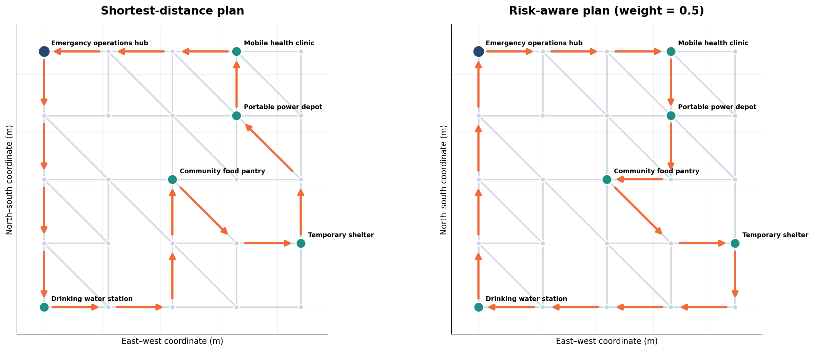
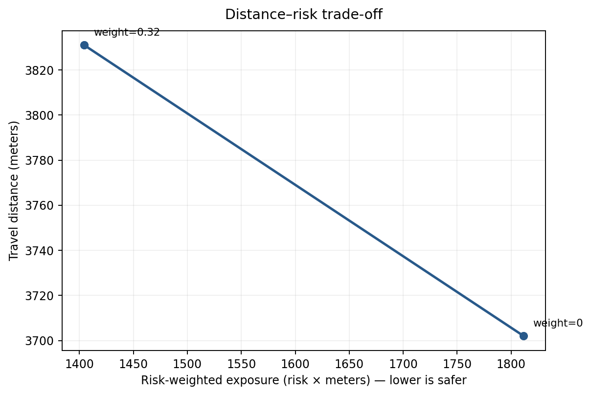

# Flood Response Routing — Risk-Aware Mixed-Integer Optimization

**Python · Gurobi / SciPy HiGHS · Mixed-Integer Programming · NetworkX · Data Visualization**

A reproducible **original, synthetic** case study of emergency logistics planning. A response vehicle must start and end at an operations hub, visit five service sites, and select a valid route through a fictional 25-node, 48-street city. We compare the **shortest-distance solution** with a **risk-aware alternative**, then test how road closures change the optimal plan.



## Key findings

| Normal-road scenario | Minimum distance | Risk-aware (`weight=0.5`) |
|---|---:|---:|
| Travel distance | **3,702 m** | **3,831 m** |
| Risk exposure (risk × m) | **1,811.56** | **1,404.42** |
| Distance vs. shortest | — | **+3.5%** |
| Exposure vs. shortest | — | **−22.5%** |

**Interpretation:** The risk-aware plan travels 129 m farther to reduce this **synthetic, relative** exposure score by approximately 22.5%. The index is **not** a real flood probability or an estimate of injuries; the weights and numbers are illustrative.



## Problem setting

A fictional community response team must visit a mobile clinic, food pantry, water station, shelter, and portable-power depot. The fleet has **one vehicle** with one continuous tour. Street segments are undirected but can only be used at most once. Intermediate intersections are optional and may be visited at most once. Some streets can be closed after extreme weather.

The data include:
- **25 locations**, including the operations hub and five required service stops.
- **48 synthetic undirected streets**, each with distance and relative flood-exposure index.
- **Two disruption scenarios** with independently specified blocked street segments.

The network geometry is schematic: where two drawn diagonal streets cross, the crossing is **not** an intersection unless a node is explicitly listed.

## Optimization model

Let `A` be both directed orientations of available undirected streets, `R` the required locations (including the hub), and `V` all nodes. Let `x[i,j]` indicate whether arc `i→j` is used and `u[i]` be an MTZ ordering variable for each non-hub node.

**Objective** (distance and exposure in meters):

\[
\min \sum_{(i,j)\in A} \left(d_{ij} + \lambda d_{ij}r_{ij}\right)x_{ij}
\]

Here `d` is street length (m), `r` is a dimensionless synthetic exposure index between 0 and 1, and `λ ≥ 0` expresses how strongly the decision-maker penalizes exposure. At `λ=0`, the model finds the shortest feasible route.

**Constraints:**

1. **Flow conservation:** incoming equals outgoing at each vertex.
2. **Required stops:** exactly one departure from each required vertex, including the hub.
3. **Optional intersections:** at most one departure from any optional vertex.
4. **No repeated streets:** `x[i,j] + x[j,i] ≤ 1` for each undirected street.
5. **No disconnected cycles:** MTZ constraints `u[i] − u[j] + (|V|−1)x[i,j] ≤ |V|−2` for all arcs whose endpoints are not the hub, with `1 ≤ u[i] ≤ |V|−1`.
6. **Binary choices:** `x[i,j] ∈ {0,1}`.

Together the constraints ensure one valid closed tour, with each required site visited once. A closed cycle that does not contain the hub would violate the MTZ ordering inequalities.

## Disruption analysis

| Scenario | Risk weight | Optimal distance | Exposure |
|---|---:|---:|---:|
| Normal | 0.0 | 3,702 m | 1,811.56 |
| Normal | 0.5 | 3,831 m | 1,404.42 |
| Flash flood | 0.0 | 4,013 m | 1,800.40 |
| Flash flood | 0.5 | 4,142 m | 1,393.26 |
| Localized outage | 0.5 | 3,831 m | 1,404.42 |

Some closures do not affect the chosen route; others force a detour. These are simulated examples, not operational guidance.

## Repository structure

```text
flood-response-routing/
├── README.md
├── Flood_Response_Routing.ipynb   # Illustrated, executable walkthrough
├── run_analysis.py               # Regenerate all metrics/figures
├── generate_data.py              # Recreate the synthetic dataset
├── requirements.txt
├── data/
│   ├── nodes.csv
│   ├── streets.csv
│   └── closures.csv
├── src/
│   ├── __init__.py
│   └── routing.py                 # Gurobi MIP and SciPy fallback
├── figures/
│   ├── route_comparison.png
│   └── risk_tradeoff.png
├── tests/
│   └── test_routing.py
├── scenario_results.csv
├── risk_sensitivity.csv
├── .gitignore
└── LICENSE
```

## Quick start

Python 3.10+ recommended.

```bash
python -m venv .venv
source .venv/bin/activate       # Windows: .venv\Scripts\activate
pip install -r requirements.txt
python run_analysis.py
python -m pytest -q
jupyter lab
```

Open **`Flood_Response_Routing.ipynb`** and run all cells from top to bottom.

The notebook and CLI use **Gurobi automatically if `gurobipy` is installed**, otherwise they use **SciPy's HiGHS mixed-integer solver** (no Gurobi license required). To choose explicitly, call `solve_route(..., backend='scipy')` or `solve_route(..., backend='gurobi')`. If Gurobi is installed but its license is not configured, select the SciPy backend explicitly. For Gurobi: `pip install gurobipy`, then activate a suitable license according to Gurobi's guidance.

Data generation is deterministic (`SEED=2026`). Run `python generate_data.py` to rebuild all three CSV data tables.

## Limitations and future work

- Synthetic risk scores represent only an **illustrative route-ranking signal** and are not calibrated hazard probabilities.
- The model assumes one vehicle, fixed service requirements, no traffic congestion, no service times, and no capacity constraints.
- A stricter model with time windows, vehicle capacity, traffic, or permitted repeat streets would be a **different optimization model** (e.g., VRP or shortest closed-walk formulations).
- Useful extensions include uncertain edge travel times, varying flood risk over time, multiple vehicles, and Pareto-efficient exposure / distance trade-offs.

## Originality and reproducibility

This is a **self-contained, fictional portfolio project**, not a release of an instructor's assignment, maps, starter notebook, or course datasets. Its dataset, storyline, code structure, and scenario results were independently created for this case study with AI assistance. Solver results were checked by automated tests using SciPy HiGHS; the optional Gurobi path requires separate verification in a licensed Gurobi environment.

Source code and generated data are shared under the MIT license; see `LICENSE`.
